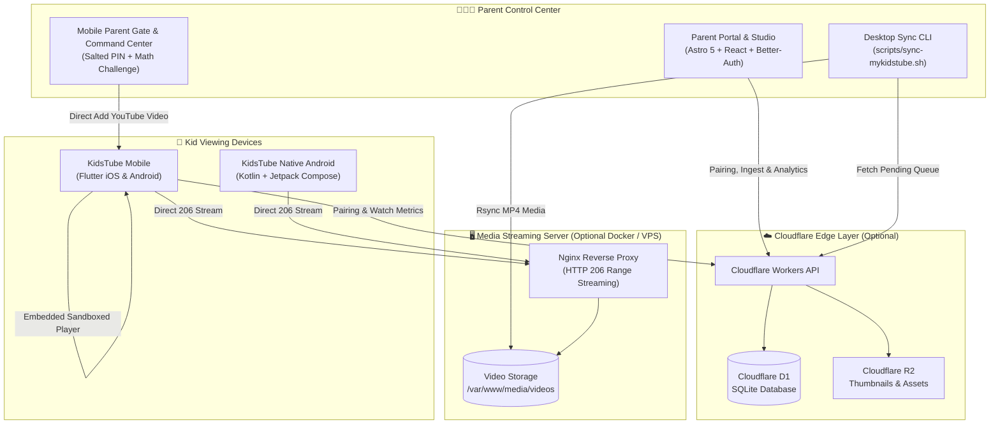

# 🎈 MyKidsTube

<p align="center">
  <strong>A calm, distraction-free, ad-free kids video ecosystem with parental controls, standalone YouTube player, and optional self-hosted streaming.</strong>
</p>

<p align="center">
  <a href="https://github.com/thewaqasPro/MyKidsTube/releases/latest"></a>
  <a href="https://flutter.dev"></a>
  <a href="https://astro.build"></a>
  <a href="https://workers.cloudflare.com"></a>
  <a href="https://www.docker.com"></a>
  <a href="LICENSE"></a>
</p>

---

## 🌟 Overview

**MyKidsTube** is an open-source, end-to-end video ecosystem purpose-built for children and parents. Unlike mainstream video platforms filled with algorithmic rabbit holes, loud advertisements, and autoplay traps, MyKidsTube empowers parents to curate a private, safe library of videos that children can watch with zero distractions.

The project offers **two flexible operating modes**:
1. **100% Standalone Mode (Zero Infrastructure):** Download the app and start watching immediately. Add any YouTube video or short directly in-app, or load our bundled 60-video curated starter pack. No VPS, no Docker, and no cloud accounts required.
2. **Optional Self-Hosted VPS / Cloudflare Mode:** Connect to your own private Nginx media server and Cloudflare D1 database for central multi-device catalog syncing, MP4 archival, and offline local downloads.

The system is designed as a modular monorepo combining:
- **Full-Featured Mobile Clients:** Flutter app (iOS & Android) and native Android (Kotlin Compose) port featuring fullscreen swipe navigation, intelligent shuffle queues, toddler locks, and authentic YouTube Dark design tokens.
- **Parental Cloud Portal & Studio:** Edge-rendered web dashboard (Astro 5 + React + Cloudflare D1) for video curation, screen time analytics, and device pairing.
- **Self-Hosted Media Streamer:** Ultra-lightweight Docker Nginx service optimized for 1GB VPS hosting with HTTP 206 byte-range streaming.
- **Desktop Sync & Ingestion Pipeline:** Automated CLI toolchain for downloading, HandBrake web optimization, YouTube ID matching, and catalog synchronization.

---

## 📐 System Architecture



---

## ✨ Key Features

### 📺 Immersive Kid Experience
- **100% Fullscreen Swipe Player:** Edge-to-edge video canvas with intuitive vertical swipe gesture (`Up ↕ Down`) to smoothly navigate through videos.
- **Authentic YouTube Dark Design System:** Styled with official YouTube Dark tokens (`#0F0F0F` canvas, `#212121` card, `#FF0000` red accent). Clean layout with controls neatly moved to a floating right action rail and wide video titles anchored at the bottom.
- **Infinite Shuffled Feed (`InfiniteVideoQueue`):** Dynamic circular queue with random round-robin selection ensuring children never hit a dead end, with rolling anti-repetition tracking.
- **Toddler Lock:** One-tap lock freezes all touch interactions, system gesture bars, and navigation so toddlers cannot exit or accidentally skip videos.
- **Curated Starter Pack (60 Videos):** 30 long videos (cartoons, rhymes, learning) and 30 authentic 9:16 vertical shorts bundled directly in the app. First-launch prompt offers immediate setup without starting from scratch.
- **Persistent Tombstone Deletion:** Deleted videos are recorded in persistent SQLite tombstones and never resurrected during app refresh or background catalog sync.

### 🛡️ Parental Control & Command Center
- **In-App YouTube Channel & Keyword Discovery:** Zero-API-key search engine. Search by channel handle (e.g. `@peppapig`, `@CoComelon`, `Ms Rachel`) or keyword. Features 1-tap instant add and multi-select batch import.
- **Standard Android Material 3 Multi-Tab Dashboard:** Clean, intuitive bottom navigation with 4 dedicated tabs (*Overview*, *Search YouTube*, *Screen Time*, *Settings & Device*). High-legibility dark surfaces (`#121212`, `#1E1E1E`) replacing harsh red dominance.
- **Clean Distraction-Free Kid Home Feed:** Removed confusing offline download arrows from video cards so children only see clean titles and high-res video thumbnails.
- **Salted SHA-256 PIN Security:** Master parent PIN protected by cryptographic salting stored in encrypted OS keychain (`FlutterSecureStorage`).
- **Direct YouTube URL Ingestion:** Paste any YouTube video, short, or playlist link to immediately fetch metadata via oEmbed and add it to the child's feed.
- **Autoplay & Session Limits:** Set maximum daily viewing or session limits (15, 30, 45, 60 min) with gentle bedtime stop screens.
- **Device Pairing:** Pair kid tablets and phones securely using one-time 6-digit activation codes without exposing credentials on the child's device.
- **Multi-Profile Management:** Create isolated profiles for different children, each with customized content categories.
- **Rich Screen Time Analytics:** Visual daily/weekly watch time graphs, completion rates, and top-watched video leaderboards.

### ⚡ Infrastructure & Performance
- **1GB VPS Ready:** Tailored Nginx configuration with aggressive buffer tuning, Cloudflare real-IP pass-through, and rate limiting designed for low-cost VPS instances.
- **HTTP 206 Byte-Range Streaming:** Instant video seek, zero buffering latency, and partial-content caching.
- **Automatic Storage Pruning:** Cloudflare D1 and VPS sync scripts automatically remove orphaned media files when videos are deleted from the portal.

---

## 📂 Repository Structure

```
MyKidsTube/
├── apps/
│   ├── mobile/                    # Primary cross-platform mobile client (Flutter for iOS & Android)
│   │   ├── assets/                # Bundled 60-video offline starter catalog
│   │   ├── android/               # Native Android runner, manifest, and Gradle configs
│   │   ├── ios/                   # Native iOS runner and Xcode workspace
│   │   ├── lib/                   # Flutter source (models, providers, screens, services, widgets)
│   │   ├── test/                  # 128 unit, widget & integration tests
│   │   ├── README.md              # Comprehensive mobile app guide
│   │   └── pubspec.yaml           # Flutter dependencies and asset registrations
│   │
│   ├── mobile-android/            # Standalone native Android port (Kotlin + Jetpack Compose)
│   │   ├── app/src/main/          # Jetpack Compose UI, AndroidX Media3 (ExoPlayer) pipeline
│   │   └── build.gradle.kts       # Android build definitions
│   │
│   ├── portal/                    # Parental web studio & API server (Astro 5 SSR + Cloudflare D1)
│   │   ├── migrations/            # D1 database schema migrations (Drizzle ORM)
│   │   ├── seeds/                 # Initial database bootstrap SQL
│   │   ├── src/                   # React Studio dashboard, analytics charts, login UI, Workers API
│   │   ├── README.md              # Web portal and API guide
│   │   ├── wrangler.json          # Cloudflare D1 database and R2 bucket bindings
│   │   └── package.json           # Portal dependencies (Astro 5, React 19, Drizzle, Tailwind)
│   │
│   └── server/                    # Self-hosted VPS media streaming service
│       ├── nginx/                 # High-performance Nginx config (HTTP 206, TLS, CORS)
│       ├── cleanup_service.py     # Secret-authenticated disk maintenance microservice
│       ├── docker-compose.yml     # Containerized server orchestration
│       ├── README.md              # VPS streamer deployment guide
│       └── .env.example           # Environment template for server configuration
│
├── docs/                          # Comprehensive technical guides & documentation
│   ├── README.md                  # Documentation index
│   ├── architecture.md            # Detailed monorepo and networking architecture
│   ├── standalone-mode-and-starter-pack.md # Standalone mode, starter pack & tombstone system
│   ├── api-reference.md           # REST API specification for Workers & VPS
│   ├── multi-user-pairing.md      # Multi-household and 5-kids pairing blueprint
│   ├── media-sync-and-renaming.md # Video ingestion, HandBrake, and YouTube ID resolution
│   ├── vps-optimization-1gb.md    # Nginx and kernel memory tuning for 1GB VPS
│   └── ai-workflow.md             # Development logs and AI implementation history
│
├── scripts/                       # Developer & operational automation toolchain
│   ├── build-apk.sh               # Builds release Android APK
│   ├── dev-server.sh              # Unified local development server runner
│   ├── make-dev-cert.sh           # Generates self-signed TLS certs for local development
│   ├── rename_videos.py           # Fuzzy YouTube ID resolver and file renamer
│   ├── sync-mykidstube.sh         # macOS residential batch downloader & VPS sync pipeline
│   ├── sync_to_d1.py              # Registers local/VPS media files into Cloudflare D1
│   └── upload_playlist_videos.py  # Playlist metadata matcher and rsync uploader
│
├── ai-prompt-generator.html       # Standalone browser tool for generating project-aware AI prompts
├── AI_PROJECT_CONTEXT.md          # Structured single-source-of-truth project specification
├── Makefile                       # Unified developer command palette
├── docker-compose.yml             # Root container configuration
└── LICENSE                        # MIT Open Source License
```

---

## 🚀 Quick Start Guide

### Developer Commands (`Makefile`)
```bash
# Start the Parent Web Portal locally (Astro SSR at http://localhost:4321)
make portal

# Start the self-hosted media server in Docker (Nginx at http://localhost:8080)
make server

# Run the Flutter mobile app in debug mode
make mobile

# Run all unit and widget tests (128 tests)
make test

# Build release Android APKs
make mobile-apk
```

---

### Running the Mobile App (`apps/mobile`)

```bash
cd apps/mobile

# Fetch dependencies
flutter pub get

# Run on connected phone or emulator
flutter run

# Run full test suite (128 unit & widget tests)
flutter test
```

#### Pre-Built Android APK Downloads (v1.4.0)
You can download pre-compiled release APKs directly from the [GitHub Releases](https://github.com/thewaqasPro/MyKidsTube/releases) page or via the in-app **Check for Updates** button in Parent Dashboard:
- **`app-arm64-v8a-release.apk`** — Optimized for modern 64-bit ARM smartphones and tablets. *(Recommended)*
- **`app-armeabi-v7a-release.apk`** — Optimized for older 32-bit ARM Android devices.
- **`app-x86_64-release.apk`** — For Chromebooks, Intel/AMD tablets, and Android emulators.
- **`app-release.apk`** — Universal build supporting all architectures.

> **What's New in v1.4.0**:
> - **Intro & Promotion Skip**: Automatically skip channel branding jingles (first 5 seconds by default) on long videos with customizable duration and parental toggles for long videos and Shorts.
> - **In-App GitHub Update Engine**: Parent Dashboard directly checks `version.json` and GitHub Releases, displays changelog notes, and triggers single-tap APK downloads.

---

## 🔒 Security & Privacy

MyKidsTube is engineered with strict child-safety and privacy fundamentals:
- **Zero Third-Party Trackers:** No analytics SDKs, no ad networks, no data profiling.
- **No Unmoderated Content:** Children only see videos that have been curated by parents or loaded from the starter catalog.
- **Sandboxed YouTube Embeds:** Privacy-enhanced iframes block comments, external links, and video recommendations.
- **Salted SHA-256 PIN Protection:** Master parent dashboard and settings require PIN verification before entry.

---

## 📖 In-Depth Documentation

Explore the **[`docs/`](docs/)** directory for detailed architecture and setup guides:
- 🏗️ **[System Architecture & Design](docs/architecture.md)** — Dual operating modes, data flow diagrams, and edge routing.
- 📦 **[Standalone Mode & Starter Pack](docs/standalone-mode-and-starter-pack.md)** — Zero-server operation, bundled 60 videos, and persistent tombstone deletions.
- 📡 **[REST API Reference](docs/api-reference.md)** — Endpoints for catalog, pairing, device sync, and watch analytics.
- 👨‍👩‍👧‍👦 **[Multi-User & Family Pairing Guide](docs/multi-user-pairing.md)** — Multi-child profile management and device onboarding.
- 💾 **[VPS Optimization Guide for 1GB RAM](docs/vps-optimization-1gb.md)** — Nginx buffer tuning, sysctl kernel limits, and zero-downtime streaming.
- 🏷️ **[Media Renaming & Ingestion Guide](docs/media-sync-and-renaming.md)** — Resolving video titles to YouTube IDs and batch rsync uploads.
- 🤖 **[AI Prompt Generator Guide](docs/ai-prompt-generator.md)** — Browser utility for project-aware AI development prompts.

---

## 🤝 Contributing

Contributions are warmly welcome! Whether you are fixing bugs, improving the video player, adding multi-language support, or optimizing streaming performance:
1. Fork the repository.
2. Create a feature branch (`git checkout -b feature/amazing-feature`).
3. Commit your changes (`git commit -m 'feat: add amazing feature'`).
4. Ensure all tests pass (`make test`).
5. Push to your branch (`git push origin feature/amazing-feature`).
6. Open a Pull Request.

---

## 📄 License

This project is licensed under the [MIT License](LICENSE).  
Designed with care for parents who want a calm, controlled, and joyful viewing experience for their children.
