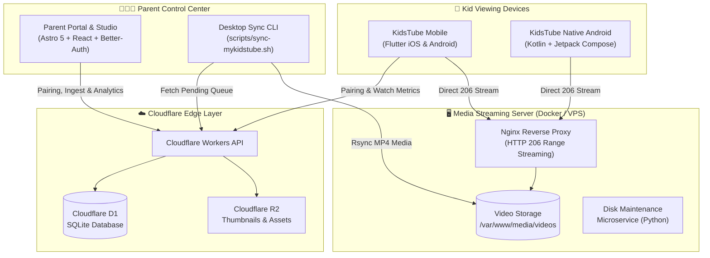

# 🎈 MyKidsTube

<p align="center">
  <strong>A calm, distraction-free, ad-free kids video ecosystem with parental controls, self-hosted streaming, and offline-first mobile apps.</strong>
</p>

<p align="center">
  <a href="https://github.com/thewaqasPro/MyKidsTube/releases/latest"></a>
  <a href="https://flutter.dev"></a>
  <a href="https://astro.build"></a>
  <a href="https://workers.cloudflare.com"></a>
  <a href="https://www.docker.com"></a>
  <a href="LICENSE"></a>
</p>

---

## 🌟 Overview

**MyKidsTube** is an open-source, end-to-end video streaming platform purpose-built for children and parents. Unlike mainstream video platforms filled with algorithmic rabbit holes, loud advertisements, and autoplay traps, MyKidsTube empowers parents to curate a private, safe library of videos that children can watch with zero distractions.

The system is designed as a modular monorepo combining:
1. **Full-Featured Mobile Clients:** Fluid Flutter app (iOS & Android) and native Android (Kotlin Compose) port featuring fullscreen swipe navigation, intelligent shuffle queues, and toddler locks.
2. **Parental Cloud Portal & Studio:** Edge-rendered web dashboard (Astro 5 + React + Cloudflare D1) for video curation, screen time analytics, and device pairing.
3. **Self-Hosted Media Streamer:** Ultra-lightweight Docker Nginx service optimized for 1GB VPS hosting with HTTP 206 byte-range streaming.
4. **Desktop Sync & Ingestion Pipeline:** Automated CLI toolchain for downloading, HandBrake web optimization, YouTube ID matching, and catalog synchronization.

---

## 📐 System Architecture



---

## ✨ Key Features

### 📺 Immersive Kid Experience
- **Fullscreen Swipe Player:** Edge-to-edge video player with intuitive vertical swipe gesture (`Up ↕ Down`) to smoothly navigate through videos.
- **Infinite Shuffled Feed (`InfiniteVideoQueue`):** Dynamic circular queue with random round-robin selection ensuring children never hit a dead end, while avoiding video repetition.
- **Dual Collapsible Drawers:** 
  - *Left Drawer:* Quick parental controls, sleep timer, Toddler Lock, and kid profile switcher.
  - *Right Drawer:* Curated playlist and suggested video thumbnails for easy manual selection.
- **Toddler Lock:** Prevents accidental touches, system bar gestures, and playback interruptions with an interactive parent unlock button.
- **Offline Playback:** Seamless local caching in SQLite and local device storage for road trips and flights.

### 🛡️ Parental Control & Studio
- **Master Account & PIN Protection:** 4-digit PIN gate or password authentication protects all sensitive parental settings.
- **Device Pairing:** Pair kid tablets and phones securely using one-time 6-digit activation codes without exposing credentials on the child's device.
- **Multi-Profile Management:** Create isolated profiles for different children (e.g. *Maya*, *Noah*, or *Shared*), each with customized content categories.
- **Rich Screen Time Analytics:** Visual daily/weekly watch time graphs, completion rates, and top-watched video leaderboards rendered in the Studio dashboard.
- **YouTube Ingestion Queue:** Paste any video or playlist link into Parent Studio; videos are queued for local batch optimization and sync.

### ⚡ Infrastructure & Performance
- **1GB VPS Ready:** Tailored Nginx configuration with aggressive buffer tuning, Cloudflare real-IP pass-through, and rate limiting designed for low-cost VPS instances.
- **HTTP 206 Byte-Range Streaming:** Instant video seek, zero buffering latency, and partial-content caching.
- **Automatic Storage Pruning:** Cloudflare D1 and VPS sync scripts automatically remove orphaned media files when videos are deleted from the portal.

---

## 📂 Repository Structure

```
MyKidsTube/
├── apps/
│   ├── mobile/                    # Primary cross-platform mobile client (Flutter for iOS & Android)
│   │   ├── android/               # Native Android runner, manifest, and Gradle configs
│   │   ├── ios/                   # Native iOS runner and Xcode workspace
│   │   ├── lib/
│   │   │   ├── models/            # Video, Profile, and Analytics data models
│   │   │   ├── providers/         # State management (AppProvider, InfiniteVideoQueue)
│   │   │   ├── screens/           # Kid player, shorts feed, and parent dashboard screens
│   │   │   ├── services/          # SQLite database service, VPS API client, sync service
│   │   │   └── widgets/           # Fullscreen swipe player, dual drawers, toddler lock
│   │   └── pubspec.yaml           # Flutter dependencies and asset registrations
│   │
│   ├── mobile-android/            # Standalone native Android port (Kotlin + Jetpack Compose)
│   │   ├── app/src/main/          # Jetpack Compose UI, AndroidX Media3 (ExoPlayer) pipeline
│   │   └── build.gradle.kts       # Android build definitions
│   │
│   ├── portal/                    # Parental web studio & API server (Astro 5 SSR + Cloudflare D1)
│   │   ├── migrations/            # D1 database schema migrations (Drizzle ORM)
│   │   ├── seeds/                 # Initial database bootstrap SQL
│   │   ├── src/
│   │   │   ├── components/        # React Studio dashboard, analytics charts, login UI
│   │   │   ├── db/                # Drizzle schema definitions (videos, profiles, devices)
│   │   │   ├── lib/               # Better-Auth configuration, D1 client helpers
│   │   │   └── pages/api/         # Cloudflare Workers REST endpoints (catalog, pairing, metrics)
│   │   ├── wrangler.json          # Cloudflare D1 database and R2 bucket bindings
│   │   └── package.json           # Portal dependencies (Astro 5, React 19, Drizzle, Tailwind)
│   │
│   └── server/                    # Self-hosted VPS media streaming service
│       ├── nginx/
│       │   ├── nginx.conf         # High-performance Nginx config (HTTP 206, TLS, CORS)
│       │   └── ssl/               # Local TLS certificates directory
│       ├── cleanup_service.py     # Secret-authenticated disk maintenance microservice
│       ├── docker-compose.yml     # Containerized server orchestration
│       └── .env.example           # Environment template for server configuration
│
├── docs/                          # Comprehensive technical guides & documentation
│   ├── architecture.md            # Detailed monorepo and networking architecture
│   ├── api-reference.md           # REST API specification for Workers & VPS
│   ├── multi-user-pairing.md      # Multi-household and 5-kids pairing blueprint
│   ├── media-sync-and-renaming.md # Video ingestion, HandBrake, and YouTube ID resolution
│   ├── vps-optimization-1gb.md    # Nginx and kernel memory tuning for 1GB VPS
│   └── ai-workflow.md             # Development logs and AI implementation history
│
├── scripts/                       # Developer & operational automation toolchain
│   ├── build-apk.sh               # Builds release Android APK
│   ├── dev-server.sh              # Unified local development server runner
│   ├── make-dev-cert.sh           # Generates self-signed TLS certs for local development
│   ├── rename_videos.py           # Fuzzy YouTube ID resolver and file renamer
│   ├── sync-mykidstube.sh         # macOS residential batch downloader & VPS sync pipeline
│   ├── sync_to_d1.py              # Registers local/VPS media files into Cloudflare D1
│   └── upload_playlist_videos.py  # Playlist metadata matcher and rsync uploader
│
├── ai-prompt-generator.html       # Standalone browser tool for generating project-aware AI prompts
├── AI_PROJECT_CONTEXT.md          # Structured single-source-of-truth project specification
├── Makefile                       # Unified developer command palette
├── docker-compose.yml             # Root container configuration
└── LICENSE                        # MIT Open Source License
```

---

## 🚀 Quick Start Guide

### Prerequisites
- **Flutter SDK:** 3.47+ (Dart 3.6+)
- **Node.js:** 20+ and `pnpm` / `npm`
- **Docker & Docker Compose:** For running the local media server
- **Python:** 3.10+ (for ingestion & sync utilities)
- **yt-dlp & ffmpeg:** `brew install yt-dlp ffmpeg` (optional, for residential video downloads)

---

### 1. Developer Commands (`Makefile`)
The root `Makefile` provides one-line commands for all subsystems:

```bash
# Start the Parent Web Portal locally (Astro SSR at http://localhost:4321)
make portal

# Start the self-hosted media server in Docker (Nginx at http://localhost:8080)
make server

# Run the Flutter mobile app in debug mode
make mobile

# Run all unit and widget tests
make test

# Build a release Android APK
make mobile-apk
```

---

### 2. Setting Up the Parental Web Portal (`apps/portal`)

The portal runs on **Astro 5** with Cloudflare D1 SQLite storage.

```bash
cd apps/portal

# Install dependencies
pnpm install

# Copy environment template
cp .env.example .env

# Apply local D1 database migrations
npx wrangler d1 migrations apply mykidstube --local

# Start development server
pnpm dev
```
Open **`http://localhost:4321`** to access the Parent Studio.

---

### 3. Setting Up the Media Server (`apps/server`)

The media streamer runs inside a lightweight Docker container:

```bash
cd apps/server

# Copy environment file
cp .env.example .env

# Generate self-signed local TLS certs
../../scripts/make-dev-cert.sh localhost

# Start container stack
docker compose up -d
```
The server exposes:
- **Port 8080 (HTTP):** Byte-range streaming (`/media/videos/{youtube_id}.mp4`) and health check (`/health`).
- **Port 8443 (HTTPS):** Secure TLS streaming endpoint.

---

### 4. Running the Flutter Mobile App (`apps/mobile`)

```bash
cd apps/mobile

# Fetch dependencies
flutter pub get

# Run on connected phone or emulator
flutter run

# Run test suite (106 unit & widget tests)
flutter test
```

#### Pre-Built Android APK
You can download the latest pre-compiled release APK directly from the [GitHub Releases](https://github.com/thewaqasPro/MyKidsTube/releases) page.

---

### 5. Media Ingestion & Sync Pipeline (`scripts/`)

To download videos on your residential connection, encode them, and sync them to your server:

```bash
# 1. Export pending URLs queued from the Parent Portal
./scripts/sync-mykidstube.sh export

# 2. Download via yt-dlp using YouTube IDs as filenames
./scripts/sync-mykidstube.sh download

# 3. (Optional) Batch-rename arbitrary video files to YouTube IDs
./scripts/sync-mykidstube.sh rename "https://www.youtube.com/playlist?list=YOUR_PLAYLIST_ID"

# 4. Upload optimized MP4s to your VPS and sync Cloudflare D1
./scripts/sync-mykidstube.sh upload
```
For a comprehensive guide on video resolution and encoding, read [docs/media-sync-and-renaming.md](docs/media-sync-and-renaming.md).

---

## 🔒 Security & Privacy

MyKidsTube is engineered with strict child-safety and privacy fundamentals:
- **No Third-Party Trackers:** No Google Analytics, no Facebook SDK, no advertising networks.
- **No Unmoderated Content:** Children can only see media that has been explicitly approved or uploaded by a parent.
- **Edge-Guarded Device Pairing:** Devices communicate via paired tokens; child devices never store master passwords.
- **PIN Protected:** Exiting to settings, modifying playlists, or switching to the parent dashboard requires the parental PIN.

---

## 📖 In-Depth Documentation

Explore the **[`docs/`](docs/)** directory for detailed architecture and setup guides:
- 🏗️ **[System Architecture & Networking](docs/architecture.md)** — Data flow diagrams, edge-to-VPS routing, and security boundaries.
- 📡 **[REST API Reference](docs/api-reference.md)** — Endpoints for catalog, pairing, device sync, and watch analytics.
- 👨‍👩‍👧‍👦 **[Multi-User & Family Pairing Guide](docs/multi-user-pairing.md)** — Architectural design for multiple children and independent parent accounts.
- 💾 **[VPS Optimization Guide for 1GB RAM](docs/vps-optimization-1gb.md)** — Nginx buffer tuning, sysctl kernel limits, and zero-downtime streaming.
- 🏷️ **[Media Renaming & Ingestion Guide](docs/media-sync-and-renaming.md)** — Resolving video titles to YouTube IDs and batch rsync uploads.
- 🤖 **[AI Prompt Generator Guide](docs/ai-prompt-generator.md)** — Using the zero-dependency browser tool for AI-assisted development.

---

## 🤝 Contributing

Contributions are warmly welcome! Whether you are fixing bugs, improving the video player, adding multi-language support, or optimizing streaming performance:

1. Fork the repository.
2. Create a feature branch (`git checkout -b feature/amazing-feature`).
3. Commit your changes (`git commit -m 'feat: add amazing feature'`).
4. Ensure all tests pass (`make test`).
5. Push to your branch (`git push origin feature/amazing-feature`).
6. Open a Pull Request.

---

## 📄 License

This project is licensed under the [MIT License](LICENSE) — see the [LICENSE](LICENSE) file for details.
Designed with care for parents who want a calm, controlled, and joyful viewing experience for their children.
