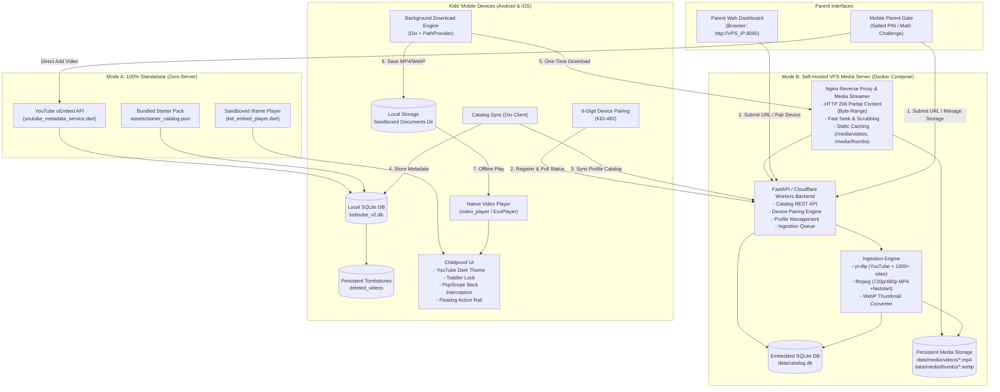
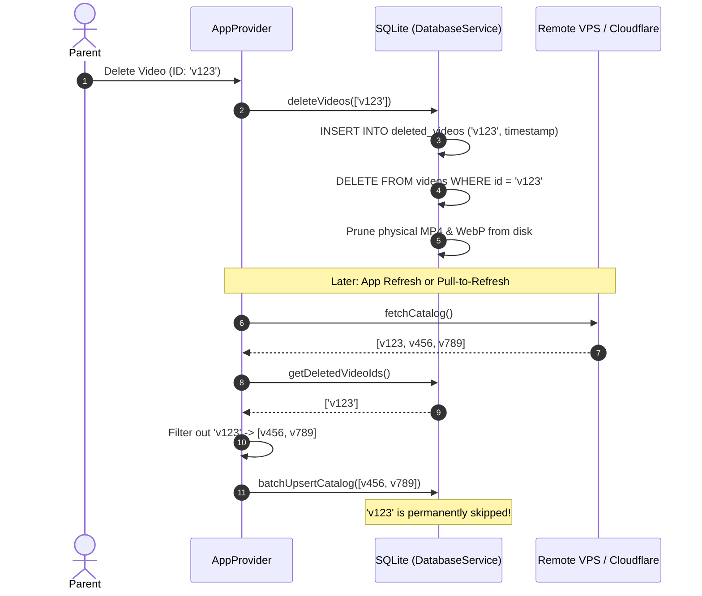

# KidsTube: System Architecture & Design

This document details the complete end-to-end architecture of KidsTube, covering the automated Dockerized VPS Media Server, Cloudflare Edge Layer, and the native offline-first Flutter mobile client with dual operating modes.

---

## 1. High-Level Architecture Diagram



---

## 2. Core Subsystems

### A. Automated Media Ingestion Engine (`yt-dlp` + `ffmpeg`)
- **Universal Provider Support:** Works with YouTube, Vimeo, Dailymotion, TikTok, and direct `.mp4` URLs.
- **Moderate Quality Profile:** Automatically normalizes uploaded streams to **720p or 480p H.264 (AVC) + AAC audio**.
- **FastStart Optimization:** Uses `-movflags +faststart` to place the MP4 `moov` atom at the beginning of the file, allowing instant playback before the full file is downloaded.
- **Deduplication:** Videos are keyed by their source URL. If two families or multiple profiles add the same video, it is only downloaded and stored on disk **once**.

### B. High-Performance Media Streaming (`Nginx`)
- Implements standard **HTTP 206 Partial Content**.
- Allows mobile players to request specific byte ranges (e.g. `Range: bytes=1048576-2097151`).
- Eliminates server RAM spikes because Nginx uses kernel-level `sendfile` directly from disk to network socket.

### C. Offline-First Mobile Storage
- **Local-First Decision Tree:**
  ```mermaid
  graph LR
      Start[Tap Video] --> Check{Is Local File on Disk?}
      Check -->|Yes| PlayLocal[Play File(localPath)<br/>Zero VPS Network Usage]
      Check -->|No| CheckEmbed{Needs Embed?}
      CheckEmbed -->|Yes| PlayEmbed[Sandboxed YouTube Player<br/>kid_embed_player.dart]
      CheckEmbed -->|No| StreamRemote[Stream NetworkUrl(streamUrl)<br/>Via Nginx Byte-Ranges]
  ```
- **Storage Sandbox:** Downloaded media is stored in `getApplicationDocumentsDirectory()/kidstube_media/`.
- **Management:** Parents can monitor total disk space used and clear cache with a single tap.

### D. Childproof Playback & Navigation
- **Hardware Back Interception (`PopScope`):** Blocks accidental swipe-to-back gestures on Android and iOS.
- **Toddler Lock:** Freezes all controls and touch events. Unlocks only after tapping the interactive lock indicator or passing the parental gate.
- **Distraction-Free Experience:** No comments, no subscribe counts, no likes/dislikes, no recommendation rabbit holes.

---

## 3. Dual Operating Modes (v1.2.0+)

### Mode 1: 100% Standalone (Recommended for standard users)
- **Zero Infrastructure:** Operates immediately upon downloading the application.
- **Direct YouTube Ingestion:** In-app modal fetches metadata via YouTube OEMBED API.
- **Bundled 60-Video Starter Pack:** Includes 30 wide videos and 30 vertical shorts bundled inside the APK.
- **No Cloud Account:** All profiles, videos, and watch stats reside exclusively on the device's encrypted SQLite database.

### Mode 2: Self-Hosted VPS / Cloudflare D1
- **Private Cloud Sync:** Centralize catalogs across up to 5 devices using 6-digit codes.
- **Local MP4 Archival:** Downloads videos directly to your home/cloud server for air-gapped offline use.

---

## 4. Tombstone Lifecycle & Resurrection Prevention

To ensure that videos deleted by parents never reappear upon app refresh or background synchronization:


