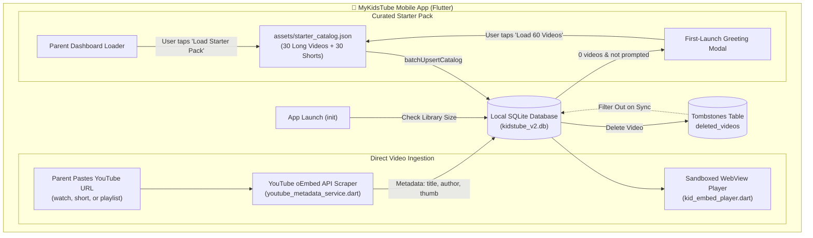

# 📦 Standalone YouTube Mode & Curated Starter Pack Architecture

## Overview

Starting with **v1.2.0**, MyKidsTube supports **100% Standalone Operation**. Families can install and run the app directly on Android and iOS devices without provisioning an external VPS, setting up Cloudflare Workers, or deploying Docker containers.

---

## 🏗️ Architecture & Component Flow



---

## 🎯 1. Standalone In-App Video Addition

Parents can add videos directly from within the app using the **Add Video** action button (`+` icon on Kid Home or within the Parent Command Center).

### Technical Flow:
1. **URL Normalization (`YouTubeMetadataService.extractVideoId`)**:
   - Parses standard watch links (`youtube.com/watch?v=ID`), short URLs (`youtu.be/ID`), and vertical shorts (`youtube.com/shorts/ID`).
2. **Metadata Scraping (`YouTubeMetadataService.fetchMetadata`)**:
   - Fetches official YouTube oEmbed metadata JSON (`https://www.youtube.com/oembed?url=...&format=json`).
   - Retrieves video title, author/channel name, and high-resolution thumbnail (`https://i.ytimg.com/vi/{id}/hqdefault.jpg`).
3. **Database Insertion**:
   - Automatically unmarks any tombstone in `deleted_videos`.
   - Inserts record into SQLite with `status = 'embed'`.
   - Video appears immediately in the child's feed.

---

## 🎬 2. Sandboxed YouTube Embed Player (`KidEmbedPlayer`)

Unlike ordinary web browsers that expose suggestions, search bars, and external links, `KidEmbedPlayer` encapsulates YouTube inside a locked, hardened WebView:

- **Parameters Injected:**
  ```
  https://www.youtube-nocookie.com/embed/{video_id}?
    autoplay=1&
    playsinline=1&
    rel=0&
    modestbranding=1&
    iv_load_policy=3&
    controls=1&
    fs=0&
    disablekb=1
  ```
- **Navigation Interception:**
  - Blocks all external navigation attempts (`onNavigationRequest` returns `NavigationDecision.prevent` for any non-embed URL).
  - Toddlers cannot click out to YouTube, ads, comments, or external apps.
- **Orientation & Sizing:**
  - Automatic 16:9 aspect ratio scaling with ambient blur backdrop for landscape videos.
  - 100% full-screen vertical canvas for Shorts with gesture navigation.

---

## 📚 3. Curated 60-Video Starter Pack

Bundled directly inside `assets/starter_catalog.json` (registered in `pubspec.yaml`):

### Distribution:
- **30 Long-Form Videos (Curated for Balance):**
  - **Cartoons (6):** Peppa Pig adventures, Blippi educational stories, CoComelon.
  - **Learning & Fun (6):** Alphabet ABC phonics, number counting (5 Little Ducks, 10 in the Bed), body part songs (One Little Finger).
  - **Songs & Music (8):** Pinkfong Baby Shark, Wheels on the Bus, Bath Song, Johny Johny Yes Papa, Who Took the Cookie.
  - **Animals & Nature (5):** Finny the Shark, Animal Sounds, Farm Animals, Gentle Ocean Waves.
  - **Bedtime Stories (5):** Twinkle Twinkle Little Star lullabies, Five Little Monkeys, Calm Mountain songs.
- **30 Vertical 9:16 Shorts & Reels:**
  - High-energy, short nursery songs and riddles from ChuChu TV, Pinkfong, and Super Simple Songs.

### Discovery & Control:
- **First Launch Prompt:** Pops up on empty catalog greeting the parent and offering to load 60 videos or start empty.
- **Parent Command Center:** Added **Curated Starter Pack** tile (`60 Videos`) with a *"Restore previously deleted starter videos"* toggle.
- **Kid Home Empty State:** When the catalog is empty, displays an inviting load button instead of a blank screen.

---

## 🛡️ 4. Persistent Tombstone Deletion Guarantee

### Problem Solved:
Previously, deleting a video only removed it from the local SQLite table. If the app refreshed or synchronized with the cloud catalog, the missing item was treated as a "new server item" and resurrected.

### Tombstone Mechanism:
1. When a video is deleted via `deleteVideos(ids)` or `deleteStandaloneVideo(id)`:
   - Its ID is immediately recorded into the persistent `deleted_videos (video_id TEXT PRIMARY KEY, deleted_at INTEGER NOT NULL)` table.
2. During any foreground sync, background refresh, or batch upsert (`batchUpsertCatalog`):
   - The query checks `getDeletedVideoIds()`.
   - Any video present in the tombstone list is strictly skipped and excluded.
3. Explicit parent restoration:
   - If a parent manually adds the video again, or selects *"Restore previously deleted starter videos"*, `unmarkDeletedVideo(id)` clears the tombstone.

---

## 🧪 5. Testing & Verification

Comprehensive tests ensure regression-free behavior:
- `test/starter_catalog_test.dart`: Validates JSON schema, 60-item integrity, load logic, and tombstone handling.
- `test/catalog_sync_safeguard_test.dart`: Verifies resurrection prevention across remote refreshes.
- `test/real_prune_database_service_test.dart`: Executes real SQLite in-memory tombstone persistence.
